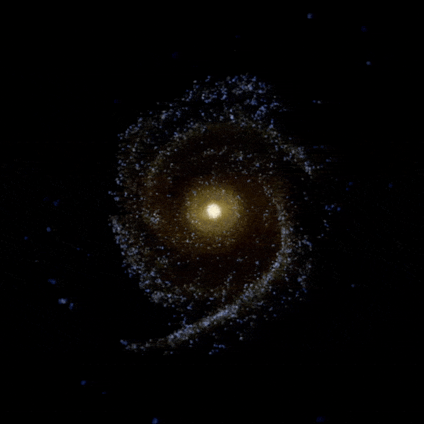

# welcome to my *spiraling* abode

the below gifs were created using the [dancing_galaxies](https://github.com/deliriousMathematician/dancing_galaxies) repo:

  
   
  

<h6 align="center">temporal animations of the stellar (left), dust (centre), and gaseous (right) components of a galactic simulation (15 kpc)</h6>

## websiteToDoList:
- review github pages
- get comfy w/ html 'n css
- start building website
- mess around w/ php &or javascript
- double pendulum applet
- mandelbrot viewer
- . . .
## pdfToDoList
- build a tool to restructure the pages of and combine pdfs 
- develope a minimalist pdf viewer for studying

not much else to see -- for now.....
